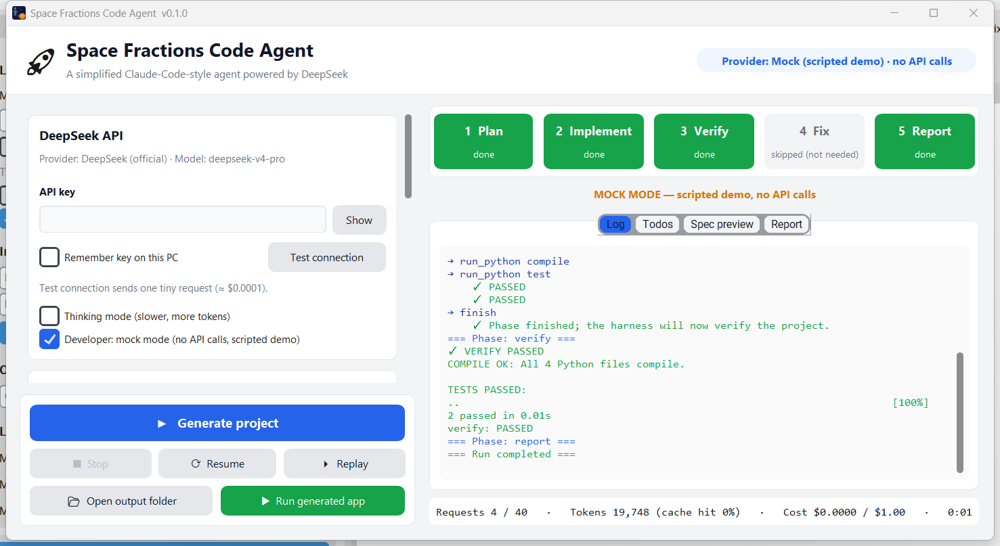

# Space Fractions Code Agent

A simplified, Claude-Code-style **code agent** for Windows. It reads an architecture document and its
PlantUML views, and uses **DeepSeek `deepseek-v4-pro`** (official API) to plan, write, test and
document a complete **desktop application**. Its reference task is the *Space Fractions* educational game.

> 🚧 Work in progress (Task 1 evaluation, Intelligent Software Engineering group). The full README,
> demo video and release follow in Phase 6.



- Requirements: [`docs/PROMPT.md`](docs/PROMPT.md)
- Research and mechanism mapping: [`docs/RESEARCH_NOTES.md`](docs/RESEARCH_NOTES.md)
- Decisions: [`docs/DECISIONS.md`](docs/DECISIONS.md)

## The agent is generic

Nothing about Space Fractions is hard-coded in the agent:

- **What to build** comes from `spec.json`. A deterministic parser builds it from *your* two Markdown files: use
  cases, classes, states, sequences, components, requirements, API contracts, DDL and detected input issues.
- **How to build it** comes from a generic system prompt. The rules are: desktop app with Tkinter, standard library
  only, adapt web/microservice designs to a desktop process, keep domain logic testable, write pytest tests,
  verify, and record design decisions.
- **Optional task hints** live in a *task profile* (`profiles/*.md`) that you pick in the GUI. They never live in
  code. `profiles/space_fractions.md` is one example.

A second, unrelated sample is included to show this: `samples/library_tracker/` (a Library Book Tracker). It is
exercised by the unit tests and in mock mode only.

## How to use with your own architecture docs

1. Write (or export) two Markdown files:
   - **Architecture documentation**: sections with headings, Markdown tables (requirements and traceability
     with ids such as `FR-1`, `NFR-2`), bullet lists of components (`* NameComponent: responsibility`) and
     optional fenced code blocks (`yaml` OpenAPI, `sql` DDL, `proto`).
   - **Architecture views**: `## <Name>View` headings, each followed by numbered titles such as
     `2. Class — Logic View: Class Diagram` and a fenced `plantuml` block (`@startuml … @enduml`). Use case,
     class, object, state, activity, sequence, package, component and deployment diagrams are understood.
     Common mistakes (Mermaid `->>` arrows, `participant` in object diagrams) are tolerated and reported.
2. In the app, choose both files under **Inputs**. Click **Preview spec.json** to see what the agent will read.
3. *(Optional)* Choose a **Task profile**: a Markdown file with extra hints and optional YAML front matter:
   ```markdown
   ---
   name: My App
   required_files: [sql/schema.sql]
   ---
   Hints for the model, e.g. which screens to build or what seed data to include.
   ```
4. Choose an **empty output folder**, set the run limits (max cost, max requests) and press **Generate project**.
5. When the run finishes, press **Run generated app**. Read `DESIGN_DECISIONS.md` and `agent_run/RUN_REPORT.md`
   in the output folder.

Tip: use **Developer: mock mode** first to check the whole pipeline at zero cost.

## License
MIT
