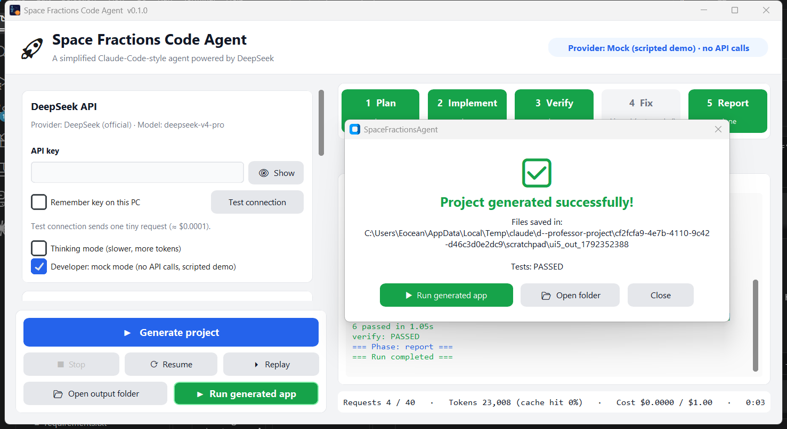
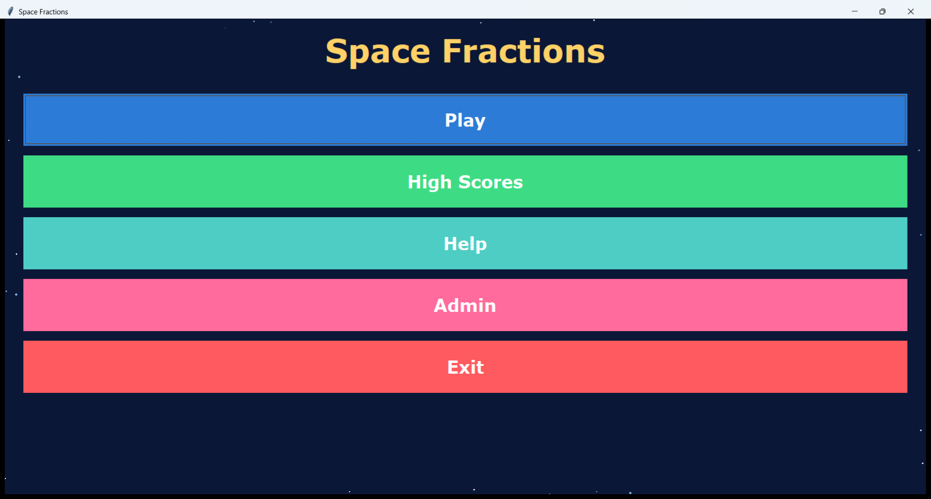
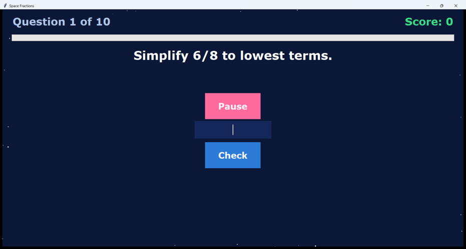
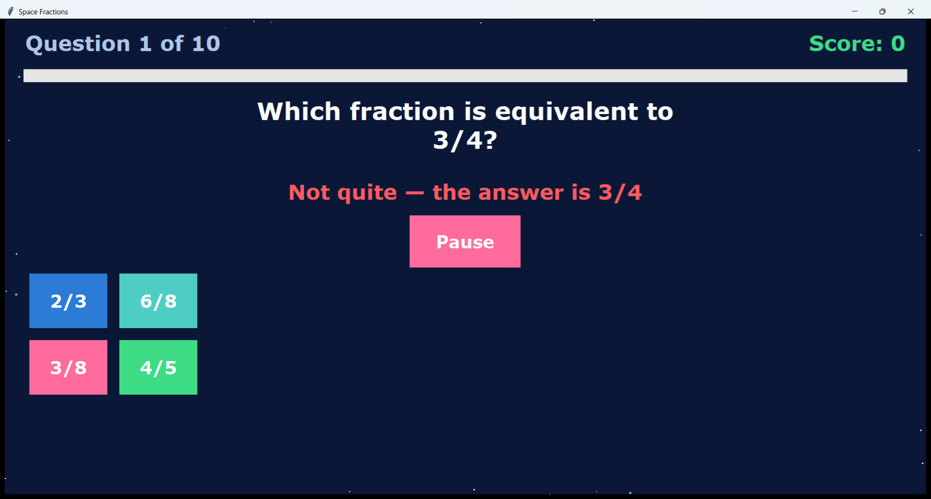
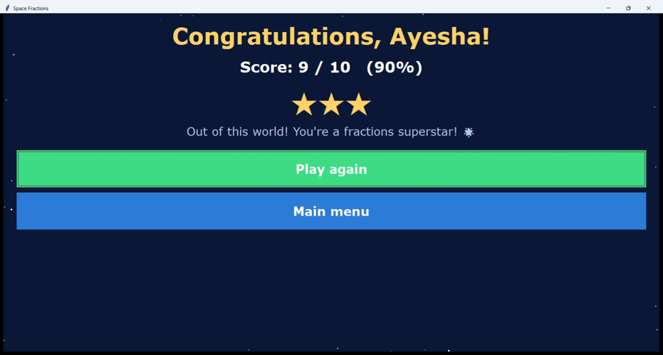
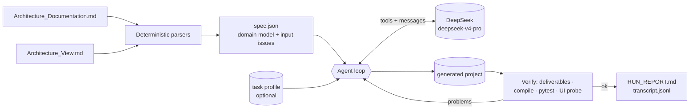

# Space Fractions Code Agent

**A simplified Claude-Code-style code agent for Windows.** It reads an architecture document and its PlantUML views,
then uses **DeepSeek `deepseek-v4-pro`** (official API) to plan, write, test, verify and document a complete
**desktop application**. The reference task is *Space Fractions*, an educational fractions game for 6th graders.

- 📦 **Download:** [latest release — `SpaceFractionsAgent.exe`](https://github.com/Mubashirakhan03/space-fractions-code-agent/releases/latest). Double-click to run; no Python needed.
- 🎬 **Demo video:** *(link added after recording)*
- 🧾 **Evidence of real runs:** [`docs/REAL_RUNS.md`](docs/REAL_RUNS.md) · final generated game: [`examples/space_fractions_run5/`](examples/space_fractions_run5/)

Task 1 evaluation for the Intelligent Software Engineering group (Prof. Peng Liang). Author: Mubashira.



| Generated game (real run 5, unedited) | |
|---|---|
|  |  |
|  |  |

---

## Quick start

1. Download `SpaceFractionsAgent.exe` from the release and double-click it. No installation and no Python are needed.
2. Paste your DeepSeek API key (it starts with `sk-`). **Test connection** sends one tiny request.
3. The two input files are pre-filled from the bundled samples (copied to `Documents\SpaceFractionsAgent\samples`).
   You can also pick your own files. Optionally choose the task profile `space_fractions`.
4. Choose an **empty output folder** and keep the hard limits (default **$1.00** and 60 requests per run).
5. Press **▶ Generate project**. You will see the phase bar (Plan → Implement → Verify → Fix → Report), the live log,
   the todo list and the running cost.
6. When the success dialog appears, press **▶ Run generated app**. The game runs on the interpreter inside the exe.

Zero-cost options: **Developer: mock mode** runs the full pipeline with a scripted demo (clearly labelled *MOCK DEMO*).
**Replay** re-runs a recorded transcript, e.g. `examples/space_fractions_run5/agent_run/transcript.jsonl`, with no API calls.

A typical real run costs about **$0.10–0.15**, because ~98 % of the prompt tokens are DeepSeek cache hits.

## How it works



1. **Preprocess (no LLM).** `app/parsers/` turns the two Markdown files into `spec.json` (JSON Schema in
   `schemas/`). The spec holds sections, tables, requirements, components, OpenAPI/SQL/proto blocks, all 13 UML
   diagrams (actors, use cases, classes, states, sequences…) and the **input issues** it detects.
2. **Plan (plan mode, read-only).** The model reconciles the spec with the desktop constraint. It writes
   DESIGN_DECISIONS.md (adaptation table, input issues, assumptions, UML → code, and a **UI design brief**), a todo
   list and the file tree.
3. **Implement.** The model writes files in batches with `write_files`. It changes them with exact search-and-replace
   `edit_file`, and runs compile and tests.
4. **Verify (harness).** The harness checks the required deliverables, compiles every file, runs pytest with the
   bundled interpreter, and runs a **UI probe**. The probe opens the real window at 1280×800 **and** at 1100×750 and
   shows every screen. It fails on off-screen or collapsed widgets, cut-off or hidden buttons, buttons covering text,
   text inputs without a submit button, and Tk callback errors.
5. **Fix.** The verification report goes back to the model, which fixes the problems itself (bounded rounds).
6. **Report.** `agent_run/RUN_REPORT.md`: provider, model, requests, tokens, cache hits, cost, verification and files.

Details: [`docs/ARCHITECTURE.md`](docs/ARCHITECTURE.md).

## Claude Code mechanisms → this agent

Sources: [`docs/RESEARCH_NOTES.md`](docs/RESEARCH_NOTES.md) (how-claude-code-works, claw-code, anthropics/claude-code).

| # | Claude Code mechanism | Implementation here |
|---|---|---|
| 1 | Two-layer agent loop | `Agent.run()` owns the session and the pipeline. `_run_phase()` sends messages + tool schemas → model tool calls → execute → `role:"tool"` results → repeat until `submit_plan`/`finish` (`app/agent/loop.py`) |
| 2 | Error recovery | Retry with backoff on 429/5xx/network errors; invalid tool JSON and missing arguments go back to the model as errors; "continue" when the output is cut off; nudges when no tool is called |
| 3 | Tool system | JSON-schema registry; read-only tools run in parallel, writes serially; errors are returned, never raised; fixed tool order (`app/tools/`) |
| 4 | Plan mode | Plan phase: only read-only tools + `update_todos` + `submit_plan`. Write tools are denied, and the harness persists the plan |
| 5 | Code editing strategy | `edit_file`: exact unique match (or `replace_all`), must read the whole file first, mtime check; `write_files` for new files; `delete_file` |
| 6 | Permissions & sandbox | Paths confined to the output folder (absolute paths, `..` and symlinks blocked); `agent_run/` read-only; no script file types; no shell; optional ask-before-write dialog |
| 7 | TodoWrite | `update_todos` (pending / in_progress / completed, one in progress), shown live in the GUI |
| 8 | Context engineering | Long tool outputs are saved to disk with a head/tail preview; microcompact of old results; auto-compact summary near the budget (the cached prefix is never touched) |
| 9 | Prompt caching | Static layered system prompt + spec first, no timestamps, fixed tool order → **~98 % cache hits** in real runs |
| 10 | System prompt design | ROLE → RULES → UI QUALITY → TOOL USAGE → OUTPUT CONTRACT, then the spec and the optional task profile; generic (no app-specific words, enforced by a test) |
| 11 | CLAUDE.md memory | `AGENT_NOTES.md` written from the plan and re-injected in every phase |
| 12 | Observability & cost | Live GUI log, `transcript.jsonl`, per-request usage, cache-hit %, cost, `RUN_REPORT.md` |
| 13 | Sessions / resume (claw-code) | `agent_run/state.json` after every step; **Resume** (used in real runs 1 and 4) |
| 14 | `doctor` (claw-code) | `SpaceFractionsAgent.exe --doctor`, plus Test connection in the GUI |
| 15 | Mock parity harness (claw-code) | `MockProvider` scenarios → 134 deterministic tests with zero API cost |
| 16 | Self-verification | Deliverables + compile + pytest + **UI probe** (real window), with bounded fix rounds |

## Web/microservice design → desktop app

The input document describes a **web-based, cloud, microservice** system (Node.js, Express, PostgreSQL, Redis,
RabbitMQ, Elasticsearch, OAuth2, Prometheus, Kubernetes…). The professor asked for a **desktop** application. The
parser flags this as `PLATFORM_CONFLICT`. The agent keeps the *logical* design and adapts the technology, and it
documents every mapping in the generated `DESIGN_DECISIONS.md`. For example, PostgreSQL becomes SQLite (same tables
plus `questions` and `scores`), REST/gRPC becomes in-process Python interfaces with the same operations,
Redis/RabbitMQ/Kubernetes are not applicable to a single-user process (with the reason), and OAuth2 becomes a local
admin passcode.

**Input issues detected automatically and handled by the agent:** empty testing matrix; `sql/question_ddl.sql` vs
`sql/game_ddl.sql`; only 4 requirement ids, with the summary's features not traced (intro, menu, questions, ending);
ASR-2 missing from the traceability table; 12 copy-pasted tech justifications; duplicated code blocks; Mermaid `->>`
arrows and `participant` in the object diagram; `artifact` used for components.

## Generic, not hard-coded

Nothing about Space Fractions is in the agent's code or system prompt. A unit test checks this. The *task profile*
`profiles/space_fractions.md` adds optional hints and required files. A second sample,
`samples/library_tracker/`, is parsed and run in mock mode by the tests.

**Use it with your own architecture docs:** write an architecture Markdown file (headings, tables with `FR-1`-style
ids, `* NameComponent: …` bullets, optional `yaml`/`sql`/`proto` blocks) and a views file (`## XView` headings, numbered
diagram titles, ```` ```plantuml ```` blocks). Pick both files in the GUI and click **Preview spec.json**. Optionally
add a profile with front matter:

```markdown
---
name: My App
required_files: [sql/schema.sql]
---
Hints for the model…
```

## Real runs (honest summary)

Five real runs used the official API. The generated code was **never edited by hand**. After each run I looked at the
real window, and when something was wrong I improved the **agent** (rules, tools, verification). Full details and
screenshots: [`docs/REAL_RUNS.md`](docs/REAL_RUNS.md).

| Run | Requests | Cost | Result | What it taught the agent |
|---|---|---|---|---|
| 1 | 44 | $0.103 | verified | canvas drawn before the window had a size → **UI probe** + `<Configure>` rule |
| 2 | 27 | $0.096 | verified first try | feedback showed the *next* item's answer → rule "capture message data before changing state" |
| 3 | 54 | $0.131 | probe found off-screen buttons → **agent fixed them itself** | pack/grid freeze → layout rule, full-flow smoke test, callback-error probe, `delete_file` |
| 4 | 57 | $0.142 | verified; 5 real-timer rounds, 0 errors | hidden/clipped buttons at small sizes → probe at minimum size, clipped-text and submit-button checks |
| 5 | 47 | $0.122 | the probe gave a false positive on a scrollable list during the run; **passed on re-verification** ([evidence](docs/run5_reverification.txt)) | **final example**: fits 1100×750, Check button, full pause overlay, 41 tests, 5 rounds with 0 errors |

Total API spend for all five runs: about **$0.68**.

## Known limitations

- **Generated game (run 5):** the intro schedules an 8-second auto-advance that Skip does not cancel. A player who
  starts a round within 8 s of launching is sent back to the menu once. The choice buttons are left-aligned rather
  than centred, and the intro screen is sparse. LLM output varies from run to run, and earlier runs (`examples/`)
  show different strengths and weaknesses, documented in [`docs/REAL_RUNS.md`](docs/REAL_RUNS.md).
- During run 5 the agent's own verification reported **FAILED** because of a false positive in the UI probe (rows of
  a scrollable list counted as off-window). The probe was fixed and the unchanged output re-verified (compile, 41
  tests, probe at both sizes, all OK). Its `RUN_REPORT.md` is kept as it was produced.
- `run_python` scripts are ordinary Python. They run in the output folder with a timeout and no API keys, but they are
  not OS-sandboxed. The model is told to change files only through the file tools.
- The UI probe checks layout and crashes generically. It does not play the app; the generated full-flow smoke test
  is responsible for that, and it does not catch every timing bug (for example the intro timer above).
- "No Python on the target PC" was verified by running the exe with Python removed from PATH, locally and on a clean
  GitHub Windows runner. A test on a second physical PC is still recommended.
- The token estimate for context compaction uses characters ÷ 4.

## Testing and building from source

```bat
py -3.12 -m venv .venv
.venv\Scripts\python -m pip install -r requirements-dev.txt
.venv\Scripts\python -m pytest            :: 134 tests, MockProvider only, no API cost
.venv\Scripts\python -m ruff check .
.venv\Scripts\python -m app.main          :: run the GUI from source
scripts\build_exe.bat                     :: → dist\SpaceFractionsAgent.exe
.venv\Scripts\python scripts\verify_exe.py   :: exe checks with no Python on PATH
```

CI (`.github/workflows/build-windows.yml`) runs lint, tests, the exe build and `verify_exe.py` on `windows-latest`
for every push, and attaches the exe to a GitHub Release for `v*` tags. A pre-commit hook
(`python scripts/install_hooks.py`) blocks commits that contain API keys. The DeepSeek key is read from the GUI,
`DEEPSEEK_API_KEY` or `.env`, and it is never logged or committed.

## Repository map

```
app/            agent (loop, prompts, context, profile, ui_probe…), tools, llm providers, parsers, gui, main
schemas/        spec.schema.json            samples/   inputs (+ library_tracker)     profiles/  task profiles
examples/       five real runs (run5 = final), each with agent_run/ transcript, state, report, logs
docs/           RESEARCH_NOTES, ARCHITECTURE, REAL_RUNS, DECISIONS, VIDEO_SCRIPT, LEARNING_NOTES_UR, CHANGELOG_WORK
tests/          134 tests (parsers, tools/sandbox, agent loop scenarios, GUI, UI probe, generality)
scripts/        build_exe.bat, verify_exe.py, run_agent_cli.py, check_secrets.py, make_icon.py
```

## Credits

- [Windy3f3f3f3f/how-claude-code-works](https://github.com/Windy3f3f3f3f/how-claude-code-works): analysis of Claude Code internals
- [ultraworkers/claw-code](https://github.com/ultraworkers/claw-code): open-source harness, mock parity harness, `doctor`, sessions
- [anthropics/claude-code](https://github.com/anthropics/claude-code): official repository (plugins, hooks, CLAUDE.md conventions)
- DeepSeek API documentation: https://api-docs.deepseek.com

## License
MIT
