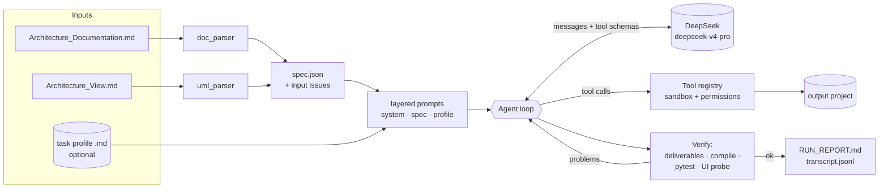
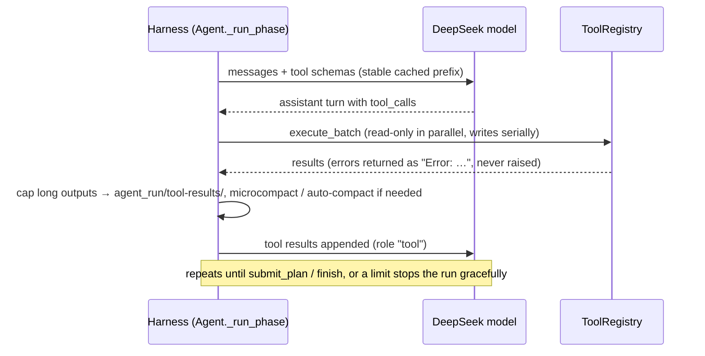

# Architecture — Space Fractions Code Agent

The agent is a small Python program built from parts that do one job each. It reproduces the core mechanisms of
Claude Code, which are described in `docs/RESEARCH_NOTES.md`.

## End-to-end flow

## Pipeline (outer loop, `app/agent/loop.py`)

| Phase | Mode | What happens |
|---|---|---|
| Plan | `plan` (read-only) | The model explores, calls `update_todos`, then `submit_plan`. The plan holds DESIGN_DECISIONS.md (adaptation table, input issues, assumptions, UML → code, **UI design brief**), the file tree and notes. The harness writes DESIGN_DECISIONS.md and AGENT_NOTES.md (as with Claude Code's ExitPlanMode). |
| Implement | `implement` | `write_files` batches, `edit_file`, `delete_file`, `run_python compile/test`, then `finish`. |
| Verify | harness | Checks that the required deliverables exist (plus the profile's `required_files`), `compile()`s every file, runs pytest with the bundled interpreter, then runs the **UI probe**. |
| Fix | `fix` (≤ N rounds) | The verification report goes back to the model, which fixes the problems with the same tools and calls `finish`. |
| Report | harness | Writes `agent_run/RUN_REPORT.md`: provider, model, requests, tokens, cache hits, cost, verification output and files. |

State is saved after every step (`agent_run/state.json`), so an interrupted run can **resume**. Every model reply
is logged in `agent_run/transcript.jsonl`, so a run can be **replayed** with zero API cost (`ReplayProvider`).

## Inner loop (one phase)

Limits: max requests, max cost (USD), max tokens, max steps, and the user's Stop button. If the reply is cut off at
the output limit, the harness asks the model to continue (up to 3 times). If the model replies without calling a
tool, the harness nudges it (up to 2 times).

## Modules

| Package | Responsibility |
|---|---|
| `app/parsers/` | Deterministic Markdown and PlantUML parsing → `spec.json` (JSON Schema in `schemas/`); input-issue detection |
| `app/llm/` | `LLMProvider` interface; `DeepSeekProvider` (official API, thinking off, retry/backoff); `MockProvider`; pricing |
| `app/agent/` | Loop, prompts, context management, todo list, state/resume, transcript/replay, report, task profiles, UI probe |
| `app/tools/` | Registry, sandbox (path guard, read-before-edit, blocked types), built-in tools, runner (bundled interpreter) |
| `app/gui/` | customtkinter window and controller (worker thread + queue), theme |
| `app/main.py` | Entry point: GUI, or the hidden `--run-pytest`, `--run-script`, `--doctor` and `--self-test` commands |

## Why the exe needs no Python

The exe ships its own interpreter. Generated tests and the generated app run as
`SpaceFractionsAgent.exe --run-pytest tests` and `SpaceFractionsAgent.exe --run-script main.py`. The child runs with
the output folder as its working directory, a timeout, and an environment with no API keys. The standard-library
modules that generated code may use are bundled from one list, `app/bundled.py`. The system prompt gives the model
the same list.

## Safety layers

1. File tools only reach paths inside the output folder. Absolute paths, `..` and symlinks that escape are rejected.
2. `agent_run/` is read-only for the model. `.exe/.bat/.ps1/…` files cannot be written.
3. Read-before-edit and an mtime check apply to `edit_file`. Edits are exact and unique search-and-replace.
4. Write tools are not available in plan mode. An optional "ask before every file write" dialog is available.
5. There are no shell tools. `run_python` only runs compile, pytest or a script through the bundled interpreter,
   with a timeout and no secrets. Scripts are ordinary Python (a known limitation, see the README).
6. Keys are never stored in the repo or written to logs. A pre-commit hook scans commits for secrets.
