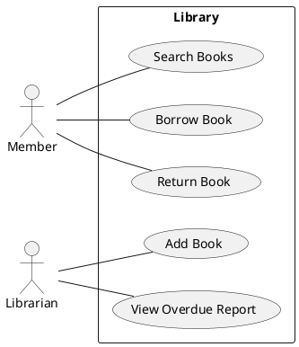
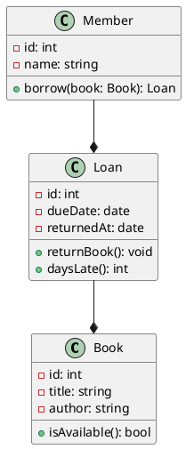
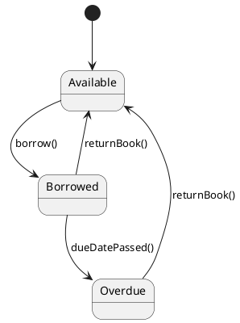
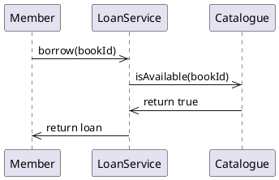
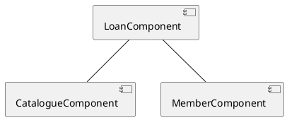

## ScenarioView
1. UseCase — Scenario View: Use Case Diagram

## LogicView
2. Class — Logic View: Class Diagram

3. State — Logic View: State Diagram

## ProcessView
4. Sequence — Process View: Sequence Diagram

## DevelopmentView
5. Component — Development View: Component Diagram

